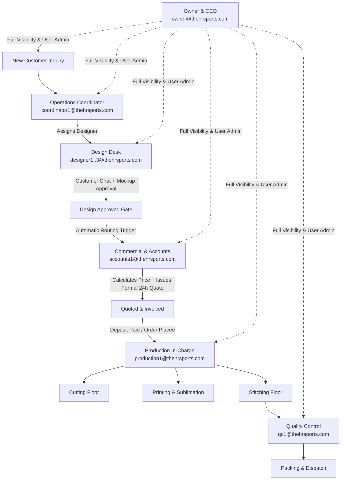

# HR Sports Manufacturing Operations — Role-Specific Dashboards Implementation Specification

> **Status:** Draft / Ready for Owner Review & Edits  
> **Last Updated:** November 2026  
> **Target System:** Manufacturing Dashboard (`factory-dashboard/`, running on port 3001)  
> **Supabase Project ID:** `pkbyeviilqdzlcvwndnd`  

---

## 1. Overview & Architectural Principle

Currently, all factory staff who log into the manufacturing operations dashboard land on the same executive view (`/`). As requested by Hafeez Bhai, each role will be provisioned with a **dedicated, role-specialized dashboard interface** tailored to their day-to-day station responsibilities.

### Key Rules & Invariants:
1. **Sequential Work Emails:** Staff log in with station-based sequential emails (e.g., `designer1@thehrsports.com`, `accounts1@thehrsports.com`). The Owner assigns employee names and resets passwords dynamically via the **Staff Attendance > User Management** console.
2. **Strict Read Receipts (Blue Ticks):** The customer portal double blue ticks (`#53bdeb`) are triggered **strictly** when the assigned **Designer** (`usman`) or **Accounts** (`umair`) reads the customer's message. Owner and Operations Coordinator views are read-only reviewers and never trigger blue ticks.
3. **Auto-Assignment Routing:** When an inquiry completes design approval (`design_approved` / `pending_quotation`), it **automatically routes to Accounts** (`accounts1@thehrsports.com`) without manual coordinator intervention.
4. **Editable Document:** This file is intended for Hafeez Bhai to review, modify, add, or remove widgets and metrics before final frontend coding.

---

## 2. Role-by-Role Dashboard Specifications



---

### ROLE 1: Owner & Executive Management
- **Work Emails:** `owner@thehrsports.com`, `owner2@thehrsports.com`
- **Current Assigned Staff:** Muhammad Hafeez (CEO), Hassan (Operations Director)
- **Primary Goal:** 360-degree factory visibility, bottleneck resolution, revenue and quotation velocity, staff attendance audit, and user password administration.

#### Top Metric Cards:
1. **Live Plant Throughput:** Total Active Inquiries, In Production Jobs, Dispatched This Week.
2. **Commercial Value Pipeline:** Quoted Value ($ USD / PKR), Pending Quotations Value, Approved Quotes.
3. **SLA Critical Alerts:** Inquiries with < 1 hour remaining or overdue SLA.
4. **Active Floor Staff:** Online staff counter, active shifts, unattended stations.

#### Main Dashboard Widgets on `/`:
- **Executive Operations Matrix:** Heatmap showing inquiries by status (`pending_designer`, `in_design`, `design_approved`, `pending_quotation`, `quoted`, `order_confirmed`, `in_production`).
- **Urgent Bottlenecks Feed:** Inquiries waiting > 24 hours without customer response or internal action.
- **Financial & Quotation Tracker:** Recent quotes issued by Accounts with margin and unit price breakdowns.
- **Factory Floor Radar:** Real-time job station status across Cutting, Sublimation, Stitching, QC, Dispatch.
- **Staff Attendance Mini-Calendar:** Direct shortcut to `/attendance-report` and `/attendance-report/users`.

#### Permitted Capabilities:
- Full read and write access across all 9 departments.
- Reset passwords, change employee names, and configure permissions in User Management.
- Ability to override any stage, reassign inquiries, or cancel orders.

---

### ROLE 2: Operations Coordinator
- **Work Email:** `coordinator1@thehrsports.com`
- **Current Assigned Staff:** Hamza
- **Primary Goal:** Rapid triage of incoming customer inquiries, assigning inquiries to available designers, and scheduling production jobs.

#### Top Metric Cards:
1. **Unassigned Inquiries Queue:** Leads newly submitted from client portal needing design triage.
2. **First-Response Clock:** Countdown timer to maintain the factory's 2-hour first-response SLA.
3. **Designer Workload Balance:** Active inquiries per designer (`designer1`: 4, `designer2`: 3, `designer3`: 2).
4. **Scheduled Production Starts:** Jobs queued for Cutting this week.

#### Main Dashboard Widgets on `/`:
- **Triage & Assignment Desk:** Direct list of `pending_designer` inquiries with one-click dropdown to allot to `designer1`, `designer2`, or `designer3`.
- **SLA Countdown Monitor:** Highlighted badges (Yellow = <1hr remaining, Red = Overdue) for prompt customer response.
- **Production Job Scheduling Board:** Calendar timeline of approved orders ready to release to the factory floor.
- **Reviewer Feed:** Inquiries currently in chat (Coordinator can view messages as a reviewer without triggering customer blue ticks).

#### Restricted Capabilities:
- Cannot issue formal commercial quotations or view financial margins.
- Cannot reset staff passwords or edit user permissions.
- Viewing an inquiry will **never** trigger blue ticks for the client.

---

### ROLE 3: Textile CAD Design Desk
- **Work Emails:** `designer1@thehrsports.com`, `designer2@thehrsports.com`, `designer3@thehrsports.com`
- **Current Assigned Staff:** Usman, Shahzaib, Faizan
- **Primary Goal:** Direct customer communication via WhatsApp-style chat, uploading 3D CAD mockups and size breakdowns, and controlling the Client Approval Gate.

#### Top Metric Cards:
1. **My Assigned Inquiries:** Active inquiries assigned directly to this designer.
2. **Awaiting Client Approval:** Mockups sent, waiting for client button click.
3. **Revisions Requested:** Inquiries where client rejected or requested art changes.
4. **Approved Today:** Designs successfully passed and auto-routed to Accounts.

#### Main Dashboard Widgets on `/`:
- **My Active Design Queue:** Split list of assigned inquiries:
  - *Needs My Action:* Client sent a new message or requested mockup adjustment.
  - *Waiting on Customer:* Mockup uploaded, approval gate unlocked, customer reviewing.
- **Direct WhatsApp Chat Launch:** Quick link to open `/inquiries/[id]` with real-time customer messaging, document vault, and inline image viewer.
- **Mockup & Tech Pack Upload Zone:** Fast drag-and-drop file uploader for `.ai`, `.pdf`, `.png`, and CAD renders into Cloudflare R2.
- **Approval Gate Toggle:** Quick action to "Unlock Client Approval" or "Confirm Design Approval".

#### Permitted & Triggered Capabilities:
- **Blue Tick Trigger:** When this designer opens and views customer messages, it **triggers the double blue tick** on the customer portal.
- On confirming design approval, system **automatically assigns Accounts** (`accounts1@thehrsports.com`) and updates status to `pending_quotation`.

#### Restricted Capabilities:
- Cannot access commercial financial figures, profit margins, or invoice generation.
- Cannot view or alter other stations' raw costings.

---

### ROLE 4: Accounts & Commercials
- **Work Emails:** `accounts1@thehrsports.com` (extensible to `accounts2@thehrsports.com`)
- **Current Assigned Staff:** Muhammad Umair
- **Primary Goal:** Automated reception of design-approved inquiries, calculating accurate fabric/printing/labor unit costs, and issuing binding 24-hour formal quotes and proforma invoices.

#### Top Metric Cards:
1. **Ready for Quotation Queue:** Inquiries with approved designs automatically routed to Accounts.
2. **Quotes Expiring in < 6 Hours:** Quotes issued that need customer closing follow-up.
3. **Total Quoted This Month ($):** Aggregate value of quotations currently with clients.
4. **Orders Booked (Deposit Verified):** Confirmed commercial orders ready for factory job creation.

#### Main Dashboard Widgets on `/`:
- **Auto-Assigned Quotation Workspace:** List of inquiries with status `design_approved` or `pending_quotation`.
- **Interactive Price Calculator:**
  - Base garment cost per piece based on GSM and fabric selection.
  - Sublimation / Screen printing / Embroidery cost per unit.
  - Custom trims, labels, individual polybag packing costs.
  - Air cargo / DHL / Sea freight shipping estimation.
  - Target margin % multiplier.
- **24-Hour Formal Quote Generator:** One-click button that compiles PDF quote with validity countdown, deposit terms (50% advance / 50% dispatch), and delivers it into customer portal chat.
- **Accounts Commercial Chat:** Direct customer communication channel for payment confirmation, wire transfer receipts, and invoice queries.

#### Permitted & Triggered Capabilities:
- **Blue Tick Trigger:** When Accounts opens and reads customer messages regarding commercial inquiries, it triggers the **double blue tick**.
- Can mark deposit payments as verified and transition order to `order_confirmed`.

#### Restricted Capabilities:
- Cannot delete or overwrite uploaded CAD vector mockups.
- Cannot change factory attendance logs or system user credentials.

---

### ROLE 5: Production In-Charge
- **Work Email:** `production1@thehrsports.com`
- **Current Assigned Staff:** Mubasher
- **Primary Goal:** Factory-wide shop floor execution, monitoring job orders through 8 sequential production stations, and balancing worker lines.

#### Top Metric Cards:
1. **Active Job Orders:** Total garments in cutting, stitching, or finishing.
2. **Daily Cutting Target vs Actual:** Target pcs vs completed bundles.
3. **Daily Stitching Line Output:** Efficiency % across active sewing tables.
4. **Dispatch Target This Week:** Orders promised for shipment within 7 days.

#### Main Dashboard Widgets on `/`:
- **Shop Floor Station Pipeline:** Visual Kanban columns showing jobs in:
  1. *Fabric Cutting & Bundling*
  2. *Plotter Printing & Sublimation*
  3. *Heat Transfer & Press*
  4. *Stitching Line Assembly*
  5. *Clipping, Ironing & Finishing*
  6. *Quality Inspection (QC)*
  7. *Polybag Packing & Carton Packing*
  8. *Final Dispatch & Carrier Handoff*
- **Station Bottleneck Warnings:** Highlighted jobs stuck at any station for > 48 hours.
- **BOM Allocation Status:** Checks whether fabric rolls and trims have been released by Store.

---

### ROLE 6: Quality Assurance / QC Lead
- **Work Email:** `qc1@thehrsports.com`
- **Current Assigned Staff:** Ashfaq
- **Primary Goal:** Floor inspection kiosk, logging defect types (stitching skips, print misalignments, shade variations), and managing AQL 1.0 audit pass/rework/reject counts.

#### Top Metric Cards:
1. **Inspected Today:** Total pcs evaluated.
2. **Pass Rate (%):** First-time pass percentage (Target: > 97.5%).
3. **Rework Queue:** Pieces returned to stitching or finishing for alteration.
4. **Rejection Count:** Scrapped units requiring remanufacture.

#### Main Dashboard Widgets on `/`:
- **Digital QC Kiosk Counter:** Large, touch-friendly counters for Pass, Minor Defect, Major Defect, and Scrapped.
- **AQL 1.0 Compliance Checklist:** Measurement verification against approved size spec sheet.
- **Defect Photo Logger:** Fast mobile/tablet upload of defect images for production feedback.
- **Clearance Certificate Release:** Formal authorization required before packing can cartonize the shipment.

---

### ROLE 7: Cutting Station Master
- **Work Email:** `cutting1@thehrsports.com`
- **Current Assigned Staff:** Shahmeer
- **Primary Goal:** Fabric marker planning, roll spreading, laser/knife bundle cutting, and size tagging.

#### Top Metric Cards & View:
- Fabric lay orders for today.
- Pcs cut by size (XS, S, M, L, XL, 2XL).
- Fabric consumption efficiency vs estimated BOM.

---

### ROLE 8: Printing & Sublimation Master
- **Work Email:** `printing1@thehrsports.com`
- **Current Assigned Staff:** Ruban Ali
- **Primary Goal:** Large-format sublimation paper printing, calendar heat press transfer, and ink density control.

#### Top Metric Cards & View:
- Active print queues linked to CAD vector files uploaded by Designers.
- Heat press temperature & dwell time monitors.
- Daily meterage completed.

---

### ROLE 9: Store & Raw Materials Master
- **Work Email:** `store1@thehrsports.com`
- **Current Assigned Staff:** Aamir
- **Primary Goal:** Raw fabric rolls in stock, trims inventory (zippers, drawstrings, woven labels, neck tags, polybags), and releasing BOM lots to Cutting.

#### Top Metric Cards & View:
- Low-stock alerts on essential fabrics (Interlock, Dri-fit, Fleece, Spandex).
- Job BOM release queue: Approving material release when job is confirmed.
- Receiving dock log for inbound mill supplies.

---

## 3. Implementation Plan & Steps

When Hafeez Bhai confirms this specification, the implementation will proceed as follows:

| Step | Component | Description |
| :--- | :--- | :--- |
| **Phase 1** | Dynamic Role Router | Modify `factory-dashboard/app/page.tsx` to read `currentRole` and render the dedicated sub-dashboard component. |
| **Phase 2** | Role Views Creation | Build `components/dashboards/`: `OwnerDashboard.tsx`, `CoordinatorDashboard.tsx`, `DesignerDashboard.tsx`, `AccountsDashboard.tsx`, `ProductionDashboard.tsx`, `QCDashboard.tsx`, `StationDashboard.tsx`, `StoreDashboard.tsx`. |
| **Phase 3** | Data Query Optimization | Create lightweight Supabase RPCs/queries tailored to fetch only what each role needs, improving mobile and low-bandwidth load times. |
| **Phase 4** | Verification & Polish | Test logins across all sequential accounts to verify exact view rendering and feature boundaries. |

---

## 4. Notes & Custom Adjustments by Owner (Hafeez Bhai)

*Please record any changes, additions, or removals in the space below:*

```
[Write your custom requirements or modifications here before we proceed to build the UI components]

- Note 1: 
- Note 2: 
- Note 3: 
```
